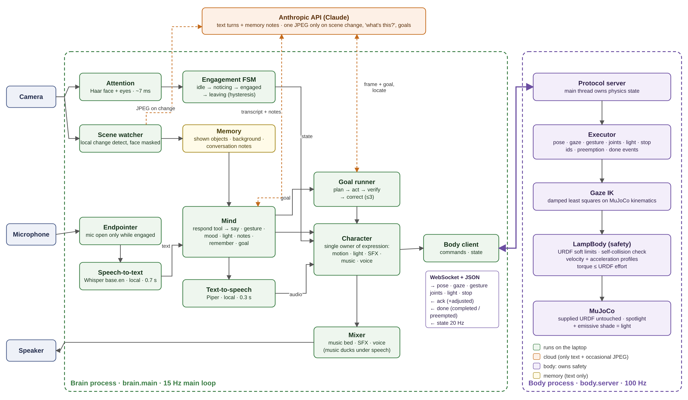

# Lumi: a live character for a 5-DOF lamp robot

Lumi brings the supplied fictional 5-DOF lamp to life in a MuJoCo simulation, using a laptop's
camera, microphone and speaker. It notices when you look at it, greets you with motion, light, sound
and voice, talks with you, remembers objects you show it, and carries out spoken goals about the
live scene ("shine your light on the book"), re-checking with the camera before it says it's done.

- **Technical note (2 pages):** [docs/TECHNICAL_NOTE.md](docs/TECHNICAL_NOTE.md) · [PDF](docs/TECHNICAL_NOTE.pdf)
- **Protocol:** [docs/PROTOCOL.md](docs/PROTOCOL.md) · **Measurements:** [docs/MEASUREMENTS.md](docs/MEASUREMENTS.md)



## Quick start

### Ubuntu 24.04 (target: 4 cores, 8 GB, no GPU)

```bash
git clone https://github.com/sadattanzim01/lamp-character.git && cd lamp-character
./scripts/install_ubuntu.sh        # apt deps, venv, API key prompt, model download + self-test
./run.sh                           # body + brain; Ctrl+C stops both
```

Options: `./run.sh --headless` (no windows), `./scripts/install_ubuntu.sh --services`
(systemd user services that start at login).

### macOS (development)

```bash
python3 -m venv .venv && source .venv/bin/activate
pip install -r requirements.txt
echo 'ANTHROPIC_API_KEY=sk-ant-...' > .env
python scripts/check_setup.py      # downloads models, tests key / mic / speaker
./run.sh                           # uses mjpython for the MuJoCo window
```

Grant camera and microphone access to your terminal app when macOS asks.

### Running the parts by hand

```bash
python -m body.server [--headless]          # macOS: mjpython -m body.server
python -m brain.main --show                  # camera debug window (q to quit)
python -m brain.main --no-voice              # engagement + character only, no API
python -m brain.main --fake --mute           # scripted visitor, no camera/mic (testing)
python -m brain.main --forget                # start with empty scene memory
```

## Repository layout

```
robot/      supplied URDF, mesh and image (untouched)
body/       body process: model build, servos + light (lamp_body), gaze IK, executor, WebSocket server
brain/      brain process
  perception/   camera, attention (face), scene watcher (cloud vision on change)
  speech/       mic endpointer, Whisper STT, Piper TTS
  engagement.py hysteresis state machine
  character.py  single owner of expression (motion, light, SFX, music, voice)
  mind.py       Claude conversation with a structured `respond` tool
  memory.py     scene memory (text notes only)
  goals.py      plan → act → re-observe → correct
  audio.py      mixer + synthesised SFX and music (no audio assets)
deploy/     systemd user units
docs/       technical note, protocol, measurements, diagram source
scripts/    install, self-test, measurement tools, early step demos
logs/       runtime logs (git-ignored): engagement, latency, goals, memory
```

## Measuring

```bash
python scripts/engagement_test.py          # scripted LOOK/AWAY reliability test (stop the brain first)
python scripts/measure_resources.py        # CPU + memory of body and brain while you use the lamp
python scripts/report.py                   # all logs → docs/MEASUREMENTS.md
python docs/render_note.py                 # technical note → PDF
```

## Configuration (`.env`)

| Variable | Default | |
|---|---|---|
| `ANTHROPIC_API_KEY` | required | |
| `LAMP_MODEL` | `claude-haiku-5-5` | conversation + scene memory (fast) |
| `LAMP_VISION_MODEL` | `claude-sonnet-5-5` | goal planning / localisation; uses non-forced tool use for models that need it, and falls back to `LAMP_MODEL` per step |
| `LAMP_STT_MODEL` | `base.en` | `tiny.en` for slower CPUs |
| `LAMP_VOICE` | `en_US-lessac-medium` | any Piper voice |

## What the cloud sees

Transcript text, short memory notes, and a single camera JPEG only when the scene changes,
when you ask about something you're showing, or for a goal. No audio is sent. The prompts forbid
describing people. Engagement, speech recognition, speech synthesis and all body safety run locally.
