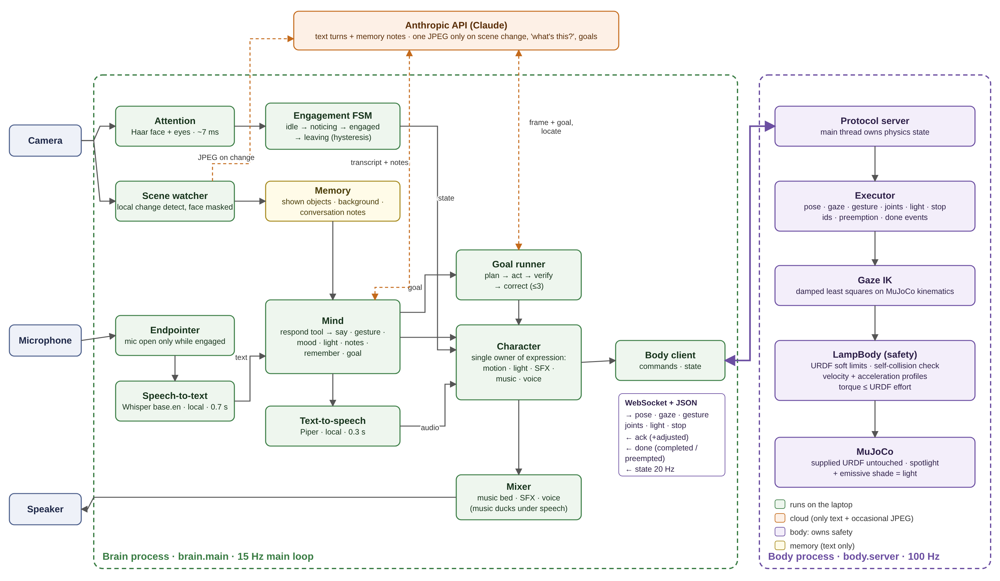

# Lumi: a live character for the 5-DOF lamp

*Sadat Tanzim. Technical note for the Live Character Robot Software Challenge.*

**Completed:** all five moments in one continuous interaction: engagement with hysteresis,
a coordinated character response (motion, light, voice, SFX, music), local-speech conversation
with Claude, scene memory with later spoken recall, and goal-directed action that re-observes and
corrects before reporting. **Left out on purpose:** wake word, barge-in, multi-person handling,
learned/VLA policies, on-robot camera simulation (see Limitations).

## 1. Architecture and protocol

Two processes with one owner each. The **body** (`body.server`) is the only code that touches the
simulator. Its main thread owns all MuJoCo state at 100 Hz; network threads only enqueue. The **brain**
(`brain.main`) owns intent: perception, engagement, conversation, memory and goals. Inside the brain,
`Character` is the single owner of expression, so motion, light, SFX, music and voice never compete.
Worker threads (speech, cloud calls) *post* actions to it instead of commanding the body directly.

**Protocol:** JSON over a local WebSocket ([PROTOCOL.md](PROTOCOL.md)). It is language-neutral and
inspectable, and it can cross a network, so the body could run on the lamp's embedded board with the
brain on a laptop. Commands: `pose`, `gaze`, `gesture`, `joints`, `light`, `stop`. Each gets an
immediate `ack` (with any `adjusted` fields), and motions later get `done: completed | preempted | rejected`.
Body `state` streams at 20 Hz (joints, measured gaze, torque fraction, light). Motion is one channel
(a new motion preempts the old one); light is a separate channel. Measured round trip on the Mac:
**median 0.7 ms**. A shared-memory or binary transport would only matter at kHz rates; low-level
control already stays inside the body.

## 2. Model-to-action boundary

| Layer | Decides | Never does |
|---|---|---|
| Claude (`respond` tool) | words; `gesture` and `mood` from the body's vocabulary; `light`; `notes`; `remember`; `goal` | joint angles |
| Goal runner | plan (target as an **image point + box**, ops `aim · light · gesture · look_at_person`); success from a **fresh frame + measured gaze** | trust the model's claim of success |
| Brain geometry | image point → gaze direction (camera intrinsics) | bypass the body |
| Body | gaze → joints (damped least-squares IK); soft limits, self-collision, velocity/acceleration, torque | know about objects |

**Goal loop:** plan → act → re-observe → correct (up to 3 times). It succeeds when the lamp's *measured* aim
point lands in the central 80 % of the object's re-detected box. In real runs this caught a 24° first miss and
converged to 2.6°, and it honestly reported `inaccurate` when a hand-held wallet kept moving. Model
coordinates were the weak link (plan and re-locate disagreed by up to 0.34 of the image width). Drawing a
labelled 0.1-step grid on the frame sent to the model fixed most of it: the next book goal hit on the first check.
(Those runs used Haiku. A configurable Sonnet path, which needs non-forced tool use, is untested at scale.)

## 3. Simulation and physical reasoning

The supplied URDF is loaded **unmodified**. A build step converts the ASCII STL, keeps the visual and
semantic frames, welds the 3 kg base to the table, and adds a spotlight with an emissive shade. Each joint
is a position servo whose **torque cap is the URDF effort**, with gravity compensation counted *inside* that
budget. Goals are clamped to the **soft** limits and followed with per-joint velocity (URDF) and acceleration
limits (3–5 rad/s² for the arm, so the base would not rock; 12 rad/s² for the light head). Peak use in the
scripted demo: 52 % of effort, every joint under its velocity limit. **Finding:** the shade's collision
cylinder hits the upper arm once `head_pitch > ~0`, although the soft limit allows +0.6 rad. The body
collision-checks every goal and lifts the head until it is clear (or rejects the goal), so the character
looks *down* by leaning its arm. Gaze IK: median 0.1°, p95 2.2°, 0 collisions over 221 targets, ~1 ms per solve.

## 4. Character, perception and cloud use

| Moment | Motion | Light | Sound |
|---|---|---|---|
| Asleep | slumped | slow warm "breathing" | music-box lullaby |
| Noticed | lifts part-way | warmer | "hm?" blip |
| Engaged | faces you, perk + wiggle, tracks your face | orange flash → focus white | music fades, chirp, spoken hello |
| Talking | gesture chosen by Claude | mood colour, intensity follows the voice | music ducks |
| Leaving / idle | tilt → droop → sleep | cool → dim warm | "bye" sigh, lullaby returns |

**Engagement:** a local Haar face + eye detector (frontal faces only, which is the "facing me" cue)
feeds a smoothed score into a hysteresis FSM: about 0.6 s of attention to engage, 1.2 s away to start
leaving. **Looking at the lamp is the wake word.** The mic is open only while engaged and is paused while the
lamp speaks (half-duplex). **Memory:** change-triggered looks (more than 2 % of thumbnail pixels changed, then
0.7 s still, face masked) store text notes per object (shown vs background, first and last seen). Conversation
facts persist as `notes` beyond the 30-message window. **Cloud boundary:** Claude receives transcript text, memory
notes and a single 512–768 px JPEG only on a scene change, a "what's this?" question, or a goal. The prompt forbids
describing people. Audio, video and engagement decisions stay local, and safety lives in the body.

## 5. Deployment (Ubuntu 24.04, 4 cores, 8 GB, no GPU)

`scripts/install_ubuntu.sh` installs PortAudio, PipeWire-ALSA, GL/EGL and v4l-utils, adds the user to
`video`/`audio`, creates a venv, and runs `check_setup.py`, which downloads Whisper base.en (int8 CTranslate2)
and a Piper voice and tests the key, mic and speaker. `./run.sh` starts the body, waits for its port and
starts the brain (`--headless` uses EGL). `--services` installs systemd *user* units: the body gets CPU priority,
the brain gets a 2–3 GB memory cap, and both restart on failure. Models were picked for CPU: Haar instead of
a DNN for the 15 Hz path, Whisper *base* (tiny mishears short commands, small is ~3× slower), Piper ~20×
real-time, and the heavy reasoning in the cloud.

## 6. Measurements

| | Result |
|---|---|
| Face detection (Mac, 4,800–8,600-frame sessions) | median 6–7 ms, p95 ≈ 10 ms |
| Engagement in use | 30 engagements, no false drop seen during long looks (up to 28 s) |
| Engagement test (10 scripted LOOK/AWAY trials) | engaged 10/10, median **1.3 s** after the cue (including the head turn); let go 10/10 (leaving 1.8 s, asleep 3.3 s); **0 false drops**; 1 false engagement (last 0.6 s of the test); face found in 97.6 % of "looking" frames |
| Spoken turn, end of speech → first audio (82 turns) | **median 3.3 s**, p95 4.4 s = 0.8 s silence wait + STT 0.7 + Claude 1.3 (1.8 with image) + TTS 0.3 |
| Goals (11) | 6 done, 1 inaccurate (moving target), 1 lost, 3 correctly "not visible"; plan 1.4 s; total 5.1 s median |
| CPU / memory (Mac M-series, 120 s of active use) | body 29 % of one core (incl. 3D viewer), 175 MB; brain 75 % mean, bursts to ~5 cores during STT/TTS, 671 MB. **Total ≈ 26 % of a 4-core machine, 846 MB peak** |
| Body only, Linux x86 headless | 3.7 % of one core, 65 MB |

Regenerate everything with `python scripts/report.py` → [MEASUREMENTS.md](MEASUREMENTS.md).

## 7. Known limitations

- **The camera is not on the head.** The webcam is fixed, so aiming assumes it sits at the lamp facing the same
  way. Verification uses re-detection plus measured joint state, not the light hitting the object. On the real
  lamp, `camera_link` would give a direct visual check.
- **Model localisation is coarse** (better with the grid overlay, still about ±5°). A local tracker seeded
  by Claude's box would be the next step.
- **Haar engagement** has no gaze or head-pose estimate and assumes one person (the largest face).
- **Latency** is dominated by the 0.8 s endpoint and the cloud call. Streaming STT, LLM and TTS would cut it by about 1 s.
- **No barge-in or wake word**, motion is collision-checked at the goal only (not along the path), and the
  measurements come from an Apple-silicon Mac (faster than the target), except the Linux body figure.
